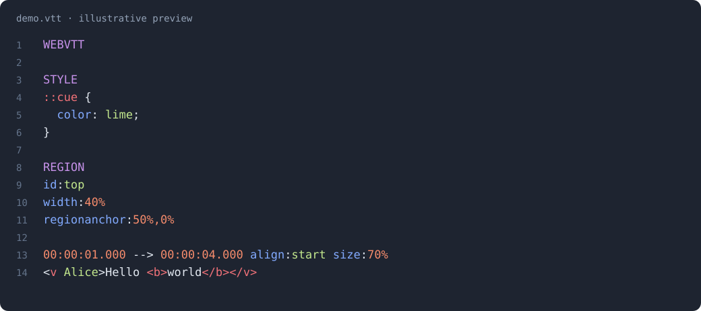

# WebVTT for Zed

[](https://github.com/jb-alvarado/zed-webvtt/actions/workflows/ci.yml)

Syntax highlighting for `.vtt` subtitle files in [Zed](https://zed.dev).



Illustrative preview; actual colors follow your Zed theme.

## Features

- Headers, cue identifiers, timestamps, and timing arrows.
- Cue settings: property names, numeric and percentage values, and text values.
- Speaker names in `<v Alice>` use the string color, like Vue class attribute values (typically green).
- Cue tags, including voice, class, bold, italic, closing, and timestamp tags.
- Entities such as `&amp;` and `NOTE` comments.
- Embedded CSS highlighting inside `STYLE` blocks using Zed's CSS support.
- `REGION` property names, numbers, percentages, coordinates, and strings.

## Installation

This extension has not yet been submitted to the Zed extension registry.
For now, install it as a dev extension:

```sh
git clone https://github.com/jb-alvarado/zed-webvtt.git
cd zed-webvtt
python3 prepare_local.py
```

On Windows, use `py prepare_local.py`. You need Git and either an installed
Tree-sitter CLI or Node.js with npm. Zed handles compilation of the grammar.

In Zed, open **Extensions → Install Dev Extension** and select
`.local/dev-extension` inside this checkout, then open `examples/demo.vtt`.
If you installed an earlier version directly from the project root, uninstall
that dev extension before installing the new generated one.

After editing the grammar or highlighting queries, rerun `prepare_local.py`
and use **Rebuild** on the dev extension.

The script regenerates the parser, snapshots the grammar into a local Git
repository, and creates the dev extension under `.local/`. It preserves the
public `extension.toml`; local paths and build artifacts are ignored by Git.

## Development

The grammar and extension live in the same repository. The public manifest
loads `tree-sitter-webvtt` from a fixed commit using Zed's grammar `path` option.

Use Node.js 22+, Python 3.11+, Git, and a C compiler for the checks:

```sh
cd tree-sitter-webvtt
npm ci
npm run generate
cd ..
python3 scripts/check.py
```

CI runs on Linux, macOS, and Windows. It checks parser generation, committed
generated sources, the six corpus tests, highlight captures, the CSS injection
range, the pinned grammar sources, and isolated local setup.

When changing grammar sources, commit the updated grammar and generated
`src/` files first, then set `[grammars.webvtt].rev` in `extension.toml` to that
commit's full SHA. This avoids trying to reference a commit from within itself.
Highlight-only changes in `languages/webvtt/` do not need a new grammar pin.
Keep the matching queries in `tree-sitter-webvtt/queries/` in sync.

The previous local grammar Git history, if present during migration, is
preserved in the ignored `.local/legacy-grammar.git` directory.

## Releases and Zed registry

GitHub releases document versions; Zed's registry publishes extensions from Git
commits, independently of GitHub releases. For a release:

1. Update `extension.toml`, the grammar package metadata, and `CHANGELOG.md`.
2. Run the checks and manually test that exact commit in Zed, including STYLE
   highlighting and colors in light and dark themes.
3. Commit the release preparation and push `main`.
4. Create and push a matching version tag, for example:

   ```sh
   git tag v0.1.0
   git push origin v0.1.0
   ```

The tag workflow runs CI and creates a **draft** GitHub release with the matching
changelog notes. Review and publish that draft on GitHub when ready. No compiled
assets are needed: Zed builds the committed parser itself.

To appear in Zed's registry, first check that equivalent WebVTT support is not
already available, then submit this repository as a submodule in
[`zed-industries/extensions`](https://github.com/zed-industries/extensions),
following the [publishing guide](https://zed.dev/docs/extensions/publishing/publishing-guide).
A GitHub release alone does not register the extension with Zed.

## Scope

This is a small highlighting grammar, not a complete WebVTT validator.
Cue identifiers containing `>` are unsupported, malformed cue markup is handled
on a best-effort basis, and all speakers share one theme color.

## License

[MIT](LICENSE), Copyright © 2026 jb-alvarado.
